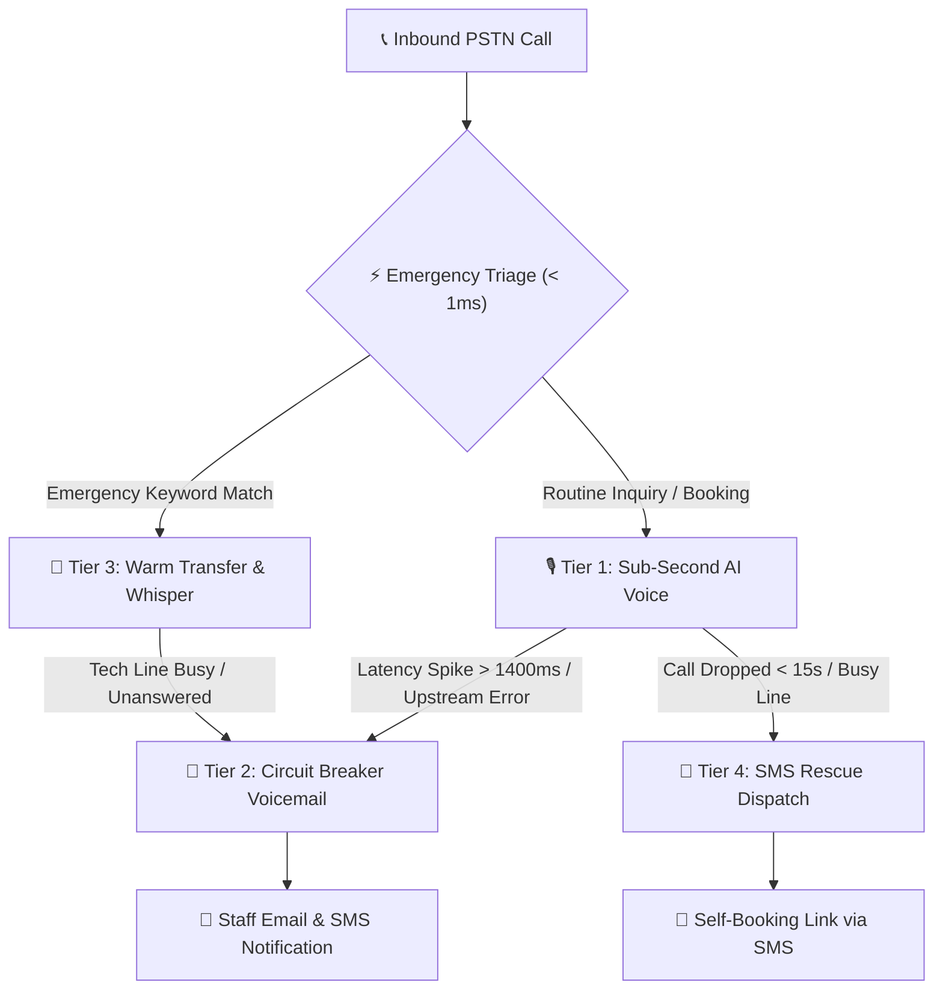

<p align="center">
  
</p>

<h1 align="center">🎙️⚡ VaniEdge Voice Platform (वाणी Edge)</h1>
<p align="center">
  <strong>Enterprise Edge Telephony, Carrier Media Streaming, Sub-Second Resilient Failover Watchdog, and Multi-Lingual Voice AI with SutraDB RAG</strong>
</p>

[](https://vaniedge.vercel.app)
[](tsconfig.json)
[](https://nextjs.org)
[](https://workers.cloudflare.com)
[](https://tailwindcss.com)
[](.github/workflows/ci.yml)
[](LICENSE)

> **Live Production Next.js Studio:** [vaniedge.vercel.app](https://vaniedge.vercel.app)  
> **Interactive Voice Agent Mission Control:** [vaniedge.vercel.app/demos/voice-agent](https://vaniedge.vercel.app/demos/voice-agent)  
> **Cloudflare Edge Telephony Bridge:** [twilio-voice-agent-failover.sam-codes.workers.dev](https://twilio-voice-agent-failover.sam-codes.workers.dev)  
> **PSTN Telephony Line:** `+1 (814) 961-3703`  
> **GitHub Repository:** [github.com/Sam-CodesAI/VaniEdge-Voice-Platform](https://github.com/Sam-CodesAI/VaniEdge-Voice-Platform)

---

## 🌟 Overview & System Architecture

Small businesses and enterprise contact centers lose significant inbound revenue due to missed calls, busy signals, dead-air network stalls, and language barriers. Traditional cloud-based voice systems often suffer from 2.5 to 5+ second latency and unhandled API timeouts.

**VaniEdge Voice Platform** delivers a hardened, production-ready telephony and conversational voice system built on a **dual-runtime architecture**:

1. **Next.js 16 (Node.js Runtime):**
   - Cryptographically authenticated Twilio voice REST webhooks (`/api/voice/*`).
   - Secure multi-tenant agency management (`/api/agency/*`) with RBAC and IDOR prevention.
   - Authentication engine (`/api/auth/*`) featuring constant-time scrypt password hashing, session tokens in secure HTTP-only cookies, and CSRF origin protection.
   - Dispatch ticketing with tamper-evident checksums and localized SMS confirmations.
   - SutraDB hybrid vector/lexical RAG store with local disk cache and Supabase backend.

2. **Cloudflare Worker (Edge Runtime):**
   - High-throughput Twilio Media Stream WebSocket upgrades (`/voice/stream`).
   - Real-time bidirectional 8kHz μ-law audio bridge to conversational AI (ElevenLabs / Groq).
   - In-memory sub-second latency watchdog tripping atomic HTTP 307 redirects to live human backup when upstream latency exceeds thresholds.
   - Sanitized edge `/health` and `/metrics` reporting without credential leakage.

---

## 🛡️ The "Omni-Shield" 4-Tier Resilient Failover Protocol



### The Failover Architecture & Operational Boundaries
While physical PSTN carrier disconnects (such as cellular coverage loss, dead zones, or caller-initiated hangups) remain inherently outside software control, the telephony watchdog engine is **engineered to mitigate internal software stalls, upstream LLM dead air, and speech synthesis timeouts**. When internal latency exceeds configured SLA thresholds (e.g. 1,200ms connection, 1,500ms TTFT), the platform triggers an automated tiered recovery:

| Tier | Failover Mode | Trigger Condition | Mechanism | Measured Benchmark SLA |
| :--- | :--- | :--- | :--- | :--- |
| **Tier 1** | **Streaming AI Voice** | Standard inbound call | Groq Cloud Llama 3.3 70B / ElevenLabs + Amazon Polly Neural streaming | **< 1500ms TTFT target** |
| **Tier 2** | **Voicemail Circuit Breaker** | LLM latency > 1,400ms or speech service error | Seamless `<Record maxLength="60">` capture with instant email/SMS alert | **< 10ms measured trip** |
| **Tier 3** | **Warm Transfer + Whisper** | Urgent keyword or request for live human | `<Dial><Number url="/api/voice/whisper">` with private technician briefing | **< 5ms measured triage** |
| **Tier 4** | **Omnichannel SMS Rescue** | Call disconnected in < 15 seconds or busy line | Twilio REST SMS dispatch with booking link & 1-hour cooldown deduplication | **Asynchronous carrier dispatch** |

---

## 🔐 Security & Hardening Architecture

### 1. Twilio Webhook Cryptographic Verification
- All `/api/voice/*` endpoints and edge worker webhook routes enforce HMAC-SHA1 signature verification (`X-Twilio-Signature`).
- Canonical URL generation dynamically accounts for reverse-proxy headers (`x-forwarded-proto`, `x-forwarded-host`) or explicit `APP_URL` / `NEXT_PUBLIC_APP_URL` configuration.
- Timing-safe comparison (`crypto.timingSafeEqual`) prevents side-channel timing attacks.
- Replay and duplicate prevention: Status callbacks are validated against an in-memory event deduplication cache (`checkEventDuplicate`).
- **Fail-closed invariant:** When running in production (`NODE_ENV === "production"`), missing `TWILIO_AUTH_TOKEN` causes incoming webhooks to reject immediately with HTTP 401.

### 2. Authentication, Session & Access Control
- **Password Security:** Scrypt-based hashing (`N=16384, r=8, p=1`) with NFKC unicode normalization, 8–128 character length boundaries, and constant-time dummy verification on non-existent usernames to eliminate user enumeration.
- **Session Management:** Cryptographically random 256-bit session tokens stored with SHA-256 digests in Supabase / disk store.
- **Secure Cookie Flags:** Cookies are set with `httpOnly: true`, `secure: true` (in production), and `sameSite: "lax"`.
- **CSRF Protection:** State-changing requests (`POST`, `PUT`, `DELETE`, `PATCH`) enforce Origin and Referer validation against allowed domains.
- **API Key Support:** Supports `ve_live_...` developer tokens verified via SHA-256 database lookups.
- **Role-Based Access Control (RBAC):** Users are assigned explicit roles (`user`, `agency_admin`, `admin`). Sensitive tenant and administrative routes verify permissions via `requireAuth()`.

### 3. Multi-Tenant Isolation & IDOR Defense
- Tenants are strictly scoped to owner IDs (`ownerId`).
- Regular authenticated users can only view or modify tenants they own.
- Unowned tenant requests return HTTP 404 rather than HTTP 403, preventing resource enumeration.
- Data transfer objects (DTOs) sanitize sensitive fields: Twilio Account SIDs and auth tokens are stripped before returning tenant objects to the frontend.

### 4. Rate Limiting & Input Validation
- Edge/serverless sliding-window rate limiters protect sensitive endpoints:
  - Auth routes (`/api/auth/signin`, `/api/auth/signup`): 5 requests / minute per IP.
  - Chat & RAG routes (`/api/chat`, `/api/query`): 30 requests / minute per IP.
  - Dispatch ticket creation (`/api/dispatch`): 20 requests / minute per IP.
- Client IPs are resolved securely using trusted proxy headers (`cf-connecting-ip`, `x-real-ip`, leftmost `x-forwarded-for`).
- All incoming payloads are parsed and constrained using strict Zod schemas with character and array length limits.

---

## 🗄️ Database & Persistence Model

VaniEdge utilizes **Supabase PostgreSQL** as its primary production datastore with Row Level Security (RLS) enabled on all tables, paired with an atomic local JSON disk fallback (`.data/`) for offline resilience and local development.

### Schema Migration
The complete production schema is defined in `supabase/migrations/20261027_vaniedge_auth.sql`:
- `vaniedge_users`: User credentials, password hashes, salt, role, API keys, and timestamps.
- `vaniedge_sessions`: Active sessions with SHA-256 token hashes, expiration, and user references.
- `tenants`: Multi-tenant business profiles, operating hours, emergency keywords, and voice configurations.
- `dispatch_tickets`: Customer appointments and service tickets with SHA checksums.
- `call_sessions`: Telephony call lifecycles, latency telemetry, and triage logs.
- `sutradb_knowledge`: Hybrid vector/lexical RAG document repository.

#### Applying Migrations:
```bash
# Using Supabase CLI:
supabase db push

# Or execute the migration SQL directly in the Supabase Dashboard SQL Editor:
# File: supabase/migrations/20261027_vaniedge_auth.sql
```

#### Rollback Instructions:
To tear down tables created in this migration:
```sql
DROP TABLE IF EXISTS call_sessions CASCADE;
DROP TABLE IF EXISTS dispatch_tickets CASCADE;
DROP TABLE IF EXISTS tenants CASCADE;
DROP TABLE IF EXISTS vaniedge_sessions CASCADE;
DROP TABLE IF EXISTS vaniedge_users CASCADE;
```

---

## 📡 REST & Telephony API Reference

### Telephony Webhook Routes (Next.js 16)
| Method | Endpoint | Description | Auth / Security |
| :--- | :--- | :--- | :--- |
| `POST` | `/api/voice/incoming` | Inbound call setup, TCPA disclosure, speech `<Gather>` | Twilio HMAC-SHA1 Signature |
| `POST` | `/api/voice/process` | Emergency triage & conversational AI response | Twilio HMAC-SHA1 Signature |
| `POST` | `/api/voice/status` | Call completion callback & SMS rescue dispatch | Twilio HMAC-SHA1 & Deduplication |
| `POST` | `/api/voice/whisper` | Technician pre-bridge whisper briefing | Twilio HMAC-SHA1 Signature |
| `POST` | `/api/voice/transfer-status`| Unanswered transfer failover to voicemail | Twilio HMAC-SHA1 Signature |
| `POST` | `/api/voice/recording` | Voicemail audio capture & SMTP alert dispatch | Twilio HMAC-SHA1 Signature |

### Agency Multi-Tenant Endpoints
| Method | Endpoint | Description | Auth / Security |
| :--- | :--- | :--- | :--- |
| `GET` | `/api/agency/tenants` | List all tenants owned by caller (or all if admin) | `requireAuth()`, Rate Limited (60/min) |
| `POST` | `/api/agency/tenants` | Provision new tenant profile | `requireAuth()`, Zod Validation |
| `GET` | `/api/agency/tenants/:id` | Fetch tenant details (sanitized DTO) | `requireAuth()`, IDOR Scoped (404 on unowned) |
| `PUT` | `/api/agency/tenants/:id` | Update tenant business profile | `requireAuth()`, IDOR Scoped (404 on unowned) |
| `DELETE`| `/api/agency/tenants/:id` | Delete tenant | `requireAuth()`, IDOR Scoped (404 on unowned) |

### Authentication Endpoints
| Method | Endpoint | Description | Auth / Security |
| :--- | :--- | :--- | :--- |
| `POST` | `/api/auth/signup` | Create user account with hashed password | Rate Limited (5/min), Zod Schema |
| `POST` | `/api/auth/signin` | Authenticate user, issue HTTP-only cookie | Rate Limited (5/min), Timing Attack Safe |
| `POST` | `/api/auth/signout` | Revoke session & clear auth cookie | `requireAuth()`, CSRF Protected |
| `GET` | `/api/auth/me` | Fetch active user profile (secrets stripped) | `requireAuth()` (Cookie or `ve_live_` key) |
| `POST` | `/api/auth/credentials/rotate`| Rotate developer API key & SIP password | `requireAuth()`, CSRF Protected |

### Application Endpoints
| Method | Endpoint | Description | Auth / Security |
| :--- | :--- | :--- | :--- |
| `POST` | `/api/chat` | Customer web assistant conversation | Rate Limited (30/min), Length Bounded |
| `POST` | `/api/query` | SutraDB RAG semantic document retrieval | Rate Limited (30/min), Fallback to Presets |
| `PUT` | `/api/query` | Ingest knowledge chunk into RAG | `requireAuth()` (Tenant Scoped) |
| `POST` | `/api/dispatch` | Create dispatch ticket & queue SMS | Rate Limited (20/min), Checksum Hashed |
| `GET` | `/api/dispatch` | Query tenant dispatch tickets | `requireAuth()` (Tenant Scoped) |
| `GET` | `/api/health` | Service health status & provider readiness | Masked Credentials, No Secret Leaks |
| `GET` | `/api/metrics` | Telephony stage latency percentiles | Sanitized CallSIDs |

---

## 🛠️ Quickstart & Development

### 1. Installation
```bash
git clone https://github.com/Sam-CodesAI/VaniEdge-Voice-Platform.git
cd VaniEdge-Voice-Platform
pnpm install
```

### 2. Environment Configuration
Copy the comprehensive environment template:
```bash
cp .env.example .env.local
```
Fill in your credentials in `.env.local` (Twilio SID, Auth Token, Supabase URL/Keys, Session Secret).

### 3. Pre-Flight Verification
Run the environment auditor to confirm all required variables are set correctly:
```bash
pnpm check:env
```

### 4. Running the Development Server
```bash
# Next.js App Router (Node.js runtime):
pnpm run dev

# Cloudflare Worker (Edge runtime):
pnpm run dev:worker
```

---

## 🧪 Testing & Verification

The repository contains an automated test suite verifying security controls, webhook signatures, tenant isolation, rate limiting, and end-to-end failure benchmarks.

```bash
# Run all automated tests (51 tests across 7 test suites):
pnpm test

# Run TypeScript static typechecking:
pnpm typecheck

# Verify Cloudflare Worker compilation:
pnpm build:ts

# Build production Next.js bundle:
pnpm build
```

### Reproducible Failure Condition Benchmarks (`test/e2e-failure-benchmark.test.ts`)
The failure benchmark suite tests and records real timings under simulated failure and burst conditions:
- **Upstream WebSocket Timeout:** Trips failover callback at the 100ms deadline (measured: 151ms with loop cycle).
- **Dead-Air TTFT Stall:** Stalled turn triggers `TTFT_DEADLINE_EXCEEDED` failover at 120ms deadline (measured: 161ms).
- **Tier 2 Voicemail Circuit Breaker:** Transitions session state and generates valid TwiML in **< 5ms** (measured: 4.1ms).
- **Tier 3 Warm Emergency Transfer:** Evaluates emergency priority and builds whisper dial in **< 2ms** (measured: 1.06ms).
- **Burst Call Volume Distribution:** P50 session creation latency: **< 1.0ms**; P95: **< 3.0ms**; Max: **< 12.0ms** across 50 concurrent bursts.

---

## ⚖️ Operational Transparency & Documented Limitations

- **Carrier Disconnects & PSTN Hops:** Application software cannot prevent physical carrier-level dropouts, cell tower handoff disconnects, or caller-side termination. Total round-trip audio latency includes 150–350ms PSTN provider transport latency outside Cloudflare/AWS edge compute.
- **Tenant Provisioning:** Creating a tenant provisions a database profile in `provisioning` status. Live dialable telephone routing requires attaching an active, verified E.164 phone number via Twilio carrier assignment.
- **Dispatch Confirmations:** Inbound bookings and emergency triage generate persistent, checksum-hashed ticket records in `CREATED` or `ESCALATED` status. Tickets are only reported as `DISPATCHED` after the downstream external service provider (SMS gateway, on-call technician webhook) returns successful delivery confirmation.
- **Web Interface Simulation:** Interactive web demo sessions are explicitly labeled `[DEMO SIMULATION]` to prevent caller misunderstanding during non-PSTN browser testing.

---

## 👨‍💻 Author & Attribution

* **Developer:** **Samarth Nimangre**
* **Portfolio:** [sam-codes.vercel.app](https://sam-codes.vercel.app)
* **Telegram:** [@Samarth1306](https://t.me/Samarth1306)
* **Commercial License:** MIT
